<link rel="stylesheet" href="https://fonts.googleapis.com/css2?family=Material+Symbols+Outlined:opsz,wght,FILL,GRAD@24,400,0,0&icon_names=favorite" />
<link rel="preconnect" href="https://fonts.googleapis.com">
<link rel="preconnect" href="https://fonts.gstatic.com" crossorigin>
<link href="https://fonts.googleapis.com/css2?family=Doto:wght@100..900&display=swap" rel="stylesheet">

 
Hiiii, my name is Kyana :)

Welcome to my page!

  

## `01 - ABOUT ME`
favorite  Currently pursuing a Master's degree in Artificial Intelligence at Open Universiteit

favorite  Bachelor's degree in Applied Computer Science at HOGENT, Microdegree in Creative Digital Design at VIVES

favorite  Based in the Flemish region, Belgium

favorite  Born on October 1st, 2003

favorite  Interested in the intersection between AI, data science, healthcare &amp; sports

## `02 - TECH STACK`
favorite  **LANGUAGES**

  

favorite  **FRAMEWORKS**

  

favorite  **TOOLS**

  

## `03 - BEYOND THE CODE`
When I'm not studying or working on something tech-related, you'll probably find me doing one of these:

favorite  **GYM** &emsp; training four times a week and always pushing myself to the limit

favorite  **HEELS (DANCE)** &emsp; moving with confidence and expressing in a creative way

favorite  **PHOTOGRAPHY** &emsp; taking pics of everything that catches my eye

## `04 - CONNECT WITH ME`
favorite  [LinkedIn](www.linkedin.com/in/kyana-marckx)

favorite  [Discord](https://discordapp.com/users/602573427228016640)

favorite  [Instagram](https://www.instagram.com/kyana.marckx/)

favorite  [Mail](mailto:kyana.marckx@gmail.com)

favorite  [Hevy](https://hevy.com/user/kiejaana03)
